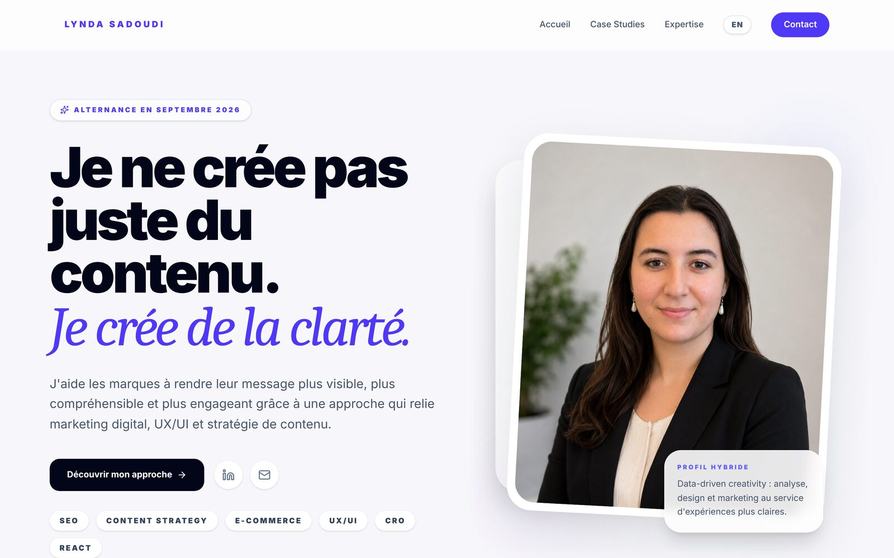

<div align="center">

# Lynda Sadoudi — Portfolio

**"I don't just create content. I create clarity."**
Bilingual (FR/EN) portfolio for a hybrid profile: front-end development × digital marketing × SEO × UX/UI.

[](https://lindasad3.github.io/lynda.dev/)
[](https://github.com/lindasad3/lynda.dev/actions)




</div>

---

## Concept

Most portfolios show **visuals**. This one shows **reasoning**: each case study explains the problem, the strategic intent and the impact — how content, design and strategy make a brand clearer, more credible and more engaging.

The site is built around a 4-step method: **Clarity → Trust → Desire → Action**.

## Case studies

| Project | Category | Angle |
|---|---|---|
| **SoftSeoul** | E-commerce & Branding | *Authority through education* — a K-Beauty brand whose content funnel educates before selling (education → authority → conversion) |
| **Kuramono** | UX Writing & Product Design | *Making the invisible clear* — UX writing and UI for an AI generative-art platform (Berlin) |
| **ColorPoint Istanbul** | Creative Strategy (B2B) | *B2B doesn't have to be boring* — visual and marketing materials that make technical services easy to sell |

## Features

- 🌍 **FR / EN toggle** on the home page
- 🎞️ Scroll-linked parallax and entrance animations with **Motion**
- 📚 Dedicated **case-study pages** (`/softseoul`, `/kuramono`, `/colorpoint`) with videos, moodboards and visuals
- ✉️ **Contact page** with a pre-filled `mailto:` form
- 🔎 SEO: French `lang`, meta description, Open Graph, `Person` JSON-LD, SVG favicon
- 🚀 **CI/CD**: lint + build on every push, automatic deploy to GitHub Pages

## Getting started

```bash
git clone https://github.com/lindasad3/lynda.dev.git
cd lynda.dev
npm install
npm run dev        # http://localhost:5173
```

| Script | Description |
|---|---|
| `npm run dev` | Start the dev server |
| `npm run build` | Production build in `dist/` |
| `npm run preview` | Preview the production build |
| `npm run lint` | ESLint |

## Project structure

```
lynda.dev/
├── src/
│   ├── Portfolio.jsx      # Home: hero, method, case studies, skills, experience, contact (FR/EN content)
│   ├── pages/             # Softseoul, Kuramono, ColorPoint, Contact
│   ├── components/        # Navbar + ui/ (Button, Badge)
│   └── lib/asset.js       # Resolves /public files against Vite's base URL
├── public/                # Images, videos, CV
├── docs/                  # README preview + project screenshots
└── .github/workflows/     # CI & deploy to GitHub Pages
```

### Deploying under a sub-path

GitHub Pages serves the site from `/lynda.dev/`. The workflow builds with `BASE_PATH=/lynda.dev/`;
Vite uses it as `base`, React Router as `basename`, and `asset()` prefixes every file from `public/`.
`404.html` is a copy of `index.html` so deep links such as `/lynda.dev/kuramono` work.
On Netlify/Vercel (domain root), simply build without `BASE_PATH`.

---

<div align="center">

**Lynda Sadoudi** — Dev × Growth · Marketing digital · SEO · UX/UI · E-commerce

[LinkedIn](https://www.linkedin.com/in/lynda-sadoudi-66008a167/) · [GitHub](https://github.com/lindasad3)

</div>
